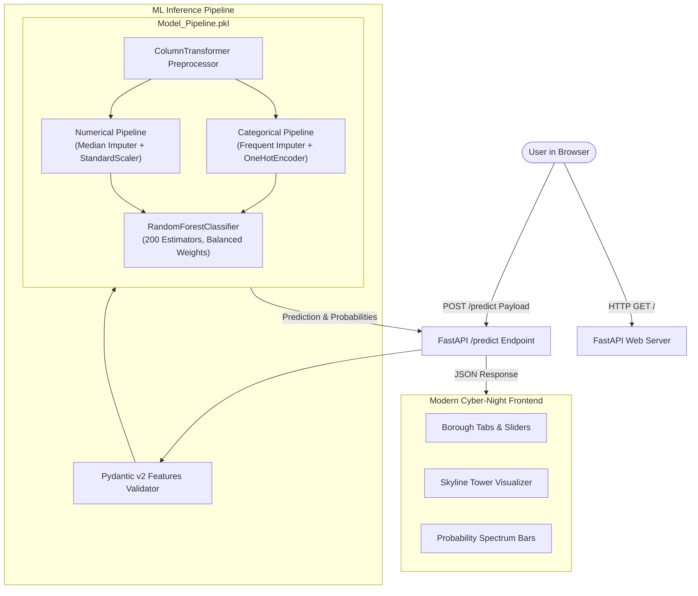

<div align="center">

# 🏙️ NYC Airbnb Room Type Predictor
### AI-Powered Classification Engine & Interactive Urban Visualization

[](https://www.python.org/)
[](https://fastapi.tiangolo.com/)
[](https://scikit-learn.org/)
[](#)
[](https://nyc-airbnb-room-type-predictor.onrender.com)

<br/>


<br/>

<p align="center">
  <strong>An end-to-end Machine Learning web application predicting New York City Airbnb listing room types from geospatial coordinates, financial metrics, host portfolio size, and booking attributes.</strong>
</p>

[Explore Web App](#quickstart) • [API Documentation](#api-endpoints) • [Model Architecture](#machine-learning-pipeline) • [Project Structure](#project-structure)

</div>

---

## ✨ Features

- **🌆 Interactive Architectural Skyline Visualizer**: A custom NYC skyline simulation where skyscraper tower heights scale dynamically and windows illuminate in glowing amber, cyan, or purple based on calibrated class probabilities.
- **⚡ Full-Stack FastAPI Server**: Serves both high-throughput REST API inference endpoints and the luxury cyber-night frontend from a single lightweight service.
- **📍 Smart NYC Borough Navigator**: Real-time borough switcher (Manhattan, Brooklyn, Queens, Bronx, Staten Island) that auto-populates exact geospatial coordinates and filters 217 authentic NYC neighborhood autocompletions.
- **🎲 Instant Listing Presets & Generator**: One-click showcase presets (*Midtown Luxury Loft*, *Williamsburg Studio*, *Astoria Co-Living*) and a smart randomizer for rapid scenario testing.
- **📊 Real-Time Financial Feedback**: Dynamic price tier badges (*Budget*, *Mid-Range*, *Premium*, *Luxury*) and host portfolio categorization (*Individual*, *Multi-Unit*, *Commercial Operator*).
- **🔄 Dual API Fallback Engine**: Seamless client-side auto-detection that tests both local backend (`http://127.0.0.1:8000`) and cloud deployment with automatic fallback and an in-app configuration modal.
- **📋 One-Click Prediction Export**: Formatted clipboard export and collapsible JSON drawer for developer debugging.

---

## 🏗️ System Architecture



---

## 🤖 Machine Learning Pipeline

The underlying model classifies listings into one of three distinct room types:
1. **Entire home/apt** *(Full private residence)*
2. **Private room** *(Dedicated bedroom with communal living spaces)*
3. **Shared room** *(Communal/partitioned quarters)*

### Feature Engineering & Preprocessing

| Feature Name | Type | Description | Preprocessing Strategy |
| :--- | :---: | :--- | :--- |
| `latitude` | `float` | Geospatial latitude (-90 to 90) | Median Imputation + `StandardScaler` |
| `longitude` | `float` | Geospatial longitude (-180 to 180) | Median Imputation + `StandardScaler` |
| `price` | `float` | Nightly booking price in USD | Median Imputation + `StandardScaler` |
| `minimum_nights` | `int` | Minimum stay duration | Median Imputation + `StandardScaler` |
| `number_of_reviews`| `int` | Total guest reviews | Median Imputation + `StandardScaler` |
| `reviews_per_month`| `float` | Monthly review velocity | Median Imputation + `StandardScaler` |
| `calculated_host_listings_count` | `int` | Total host listings in NYC | Median Imputation + `StandardScaler` |
| `availability_365`| `int` | Days bookable per year (0–365) | Median Imputation + `StandardScaler` |
| `neighbourhood_group` | `str` | Borough (Manhattan, Brooklyn, etc.) | Mode Imputation + `OneHotEncoder` |
| `neighbourhood` | `str` | 217 NYC Neighborhoods | Mode Imputation + `OneHotEncoder` |

### Classifier Specifications
- **Algorithm**: `RandomForestClassifier`
- **Estimators**: 200 Decision Trees
- **Class Weights**: `balanced` *(to handle rare Shared Room class distribution)*
- **Min Samples Split**: 10
- **Serialization**: `joblib` (`Model_Pipeline.pkl`)

---

## 🚀 Quickstart

### Prerequisites
- Python 3.10, 3.11, or 3.12
- Git

### 1. Clone the Repository
```bash
git clone https://github.com/kunalnaik46/NYC-Airbnb-Room-Type-Predictor.git
cd NYC-Airbnb-Room-Type-Predictor
```

### 2. Set Up Virtual Environment
```bash
# Windows
python -m venv venv
.\venv\Scripts\activate

# macOS / Linux
python3 -m venv venv
source venv/bin/activate
```

### 3. Install Dependencies
```bash
pip install -r requirements.txt
```

### 4. Run the Application
```bash
python -m uvicorn main:app --reload --host 127.0.0.1 --port 8000
```

Open your browser at **[http://127.0.0.1:8000/](http://127.0.0.1:8000/)** to interact with the web app!

---

## 📡 API Endpoints

### 1. `POST /predict`
Performs room type classification inference.

#### Request Example
```bash
curl -X POST "http://127.0.0.1:8000/predict" \
     -H "Content-Type: application/json" \
     -d '{
       "latitude": 40.7549,
       "longitude": -73.9840,
       "price": 285.0,
       "minimum_nights": 3,
       "number_of_reviews": 72,
       "reviews_per_month": 2.4,
       "calculated_host_listings_count": 1,
       "availability_365": 240,
       "neighbourhood_group": "Manhattan",
       "neighbourhood": "Midtown"
     }'
```

#### Response Example
```json
{
  "status": "success",
  "predicted_room_type": "Entire home/apt",
  "confidence": 0.8763,
  "confidence_percentage": "87.6%",
  "probabilities": {
    "Entire home/apt": 0.8763,
    "Private room": 0.1237,
    "Shared room": 0.0000
  },
  "ranked_predictions": [
    { "room_type": "Entire home/apt", "probability": 0.8763, "percentage": "87.6%" },
    { "room_type": "Private room", "probability": 0.1237, "percentage": "12.4%" },
    { "room_type": "Shared room", "probability": 0.0000, "percentage": "0.0%" }
  ],
  "listing_summary": {
    "price_tier": "Premium / Luxury",
    "borough": "Manhattan",
    "neighbourhood": "Midtown"
  },
  "Predicted_room_type": "Entire home/apt",
  "Probability": [0.8763, 0.1237, 0.0]
}
```

### Other Endpoints
| Method | Path | Description |
| :---: | :--- | :--- |
| `GET` | `/` | Web application HTML or JSON health depending on `Accept` header |
| `GET` | `/api/health` | Service health status and loaded model classes |
| `GET` | `/api/examples` | Curated showcase listing presets across boroughs |
| `GET` | `/docs` | Interactive OpenAPI Swagger documentation |

---

## 📂 Project Structure

```text
NYC-Airbnb-Room-Type-Predictor/
├── assets/
│   ├── nyc_logo.jpg         # Luxury branded app icon
│   └── nyc_skyline.jpg      # Panoramic NYC twilight photography
├── .gitignore               # Comprehensive Git ignore rules
├── index.html               # Redesigned semantic HTML5 web interface
├── style.css                # Luxury urban cyber-night styling & design tokens
├── script.js                # Interactive visualizer, presets, & dual-API fallback
├── scripts.js               # Forwarding script for compatibility
├── main.py                  # FastAPI server & Scikit-Learn inference handler
├── Model_Pipeline.pkl       # Serialized Scikit-Learn Random Forest pipeline (37.8 MB)
├── nyc_airbnb_room_type_classification.ipynb # Exploratory data analysis & model training notebook
├── requirements.txt         # Project dependencies with pinned versions
├── runtime.txt              # Python runtime target for cloud deployments
└── README.md                # Project documentation & reference
```

---

## 🛠️ Technology Stack

| Layer | Technologies |
| :--- | :--- |
| **Backend & API** | Python 3.12, FastAPI, Pydantic v2, Uvicorn |
| **Machine Learning** | Scikit-Learn, Pandas, NumPy, Joblib |
| **Frontend Core** | HTML5, Modern Vanilla JavaScript (ES6+), Vanilla CSS |
| **Design System** | Midnight Glassmorphism, Google Fonts (*Plus Jakarta Sans*, *Space Grotesk*, *JetBrains Mono*) |
| **Data Source** | [New York City Airbnb Open Data (Inside Airbnb)](http://insideairbnb.com/) |

---

## 📄 License
This project is open-source and available under the [MIT License](LICENSE).
